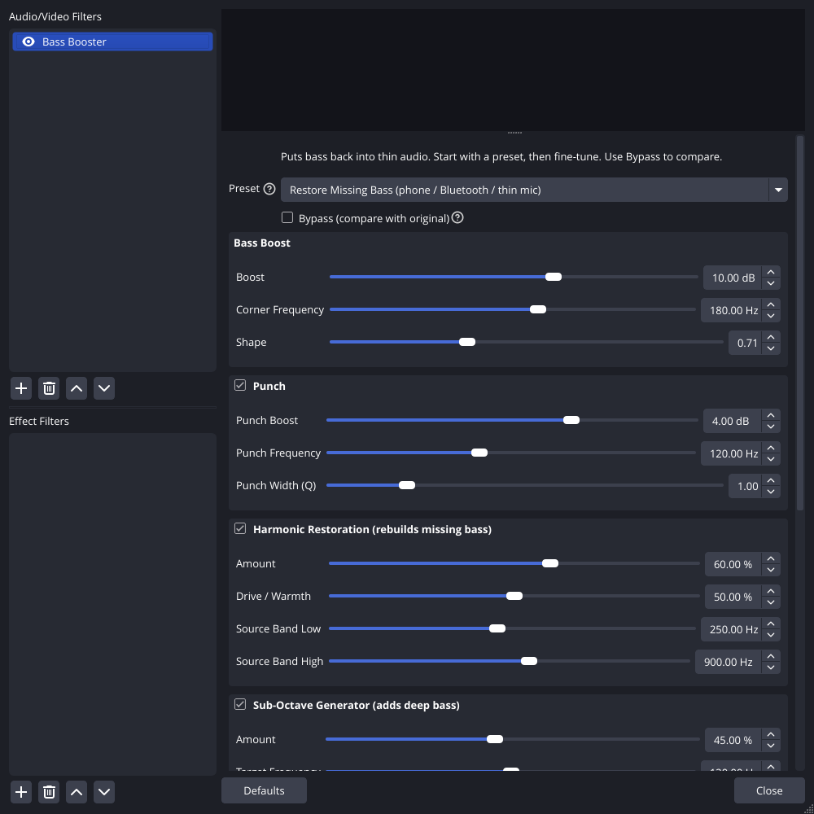
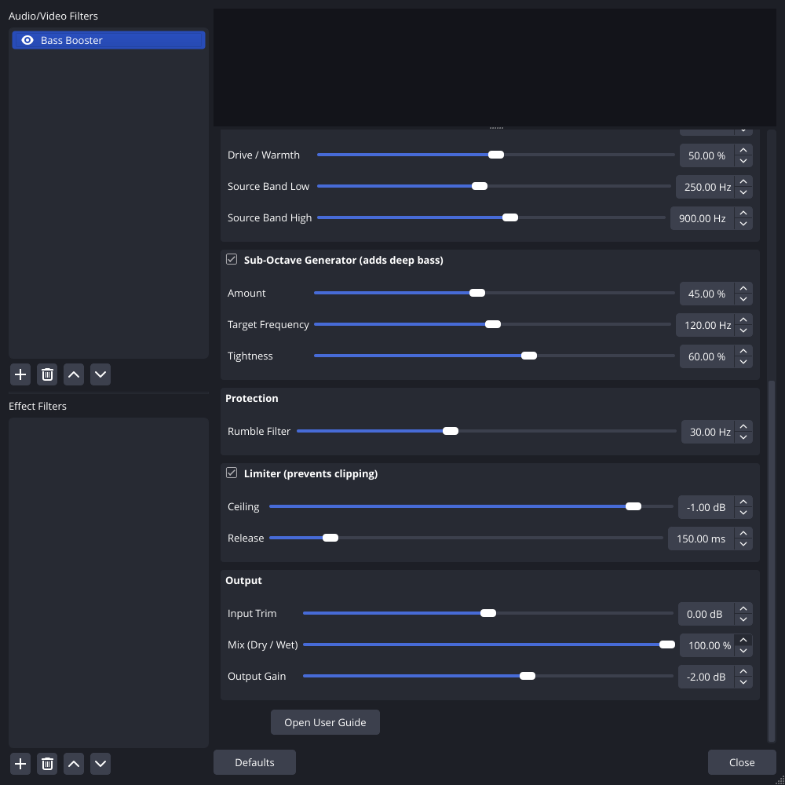
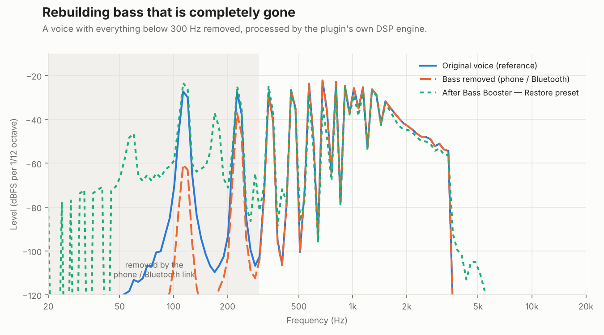

# Bass Booster for OBS

**An OBS Studio audio filter that puts bass back into thin audio, including audio where the bass is gone completely.**

Add it under *Audio Mixer → ⋮ → Filters → + → Bass Booster*, pick a preset, and adjust from there.

<p align="center">
  
  
</p>
<p align="center"><sub>These are real screenshots of the plugin running in OBS Studio 30.2.3.</sub></p>

## Why not just use an EQ?

An equaliser can only make louder what is already there. When audio arrives with **no bass at all**, an EQ boost has nothing to work with. This happens with a Bluetooth headset in "hands-free" mode, VoIP and Discord audio, laptop microphones, or a hardware low-cut filter.

Bass Booster combines a normal bass EQ with two engines that **create new bass**:

| Engine | What it does |
|---|---|
| **Bass Boost** (low shelf) | Raises everything below a corner frequency. This is the main "more bass" control. |
| **Punch** (bell EQ) | Adds thump or chest to one region of the low end. |
| **Harmonic Restoration** | Rebuilds a **missing fundamental** from the harmonics that survived. When harmonics at 3f, 4f, 5f… pass through a rectifier, their difference frequency *f* comes out at the correct pitch. |
| **Sub-Octave Generator** | Creates real new bass **one octave below** the input, like an analogue subharmonic synth (dbx 120 style). |
| **Rumble Filter** | A 24 dB/octave high-pass that removes inaudible infrasonic energy that would otherwise waste headroom. |
| **Limiter** | A zero-latency, channel-linked peak limiter, so the extra bass never clips your stream. |



*The chart above comes from the plugin's own engine. It processes a voice with everything below 300 Hz removed. The missing 115 Hz fundamental goes from −62 dB to −24 dB, back to about the level of the original voice (−27 dB).*

## Features

- **Six presets**: Subtle Warmth, Voice Body, Music Boost, Restore Missing Bass, Extreme and Custom. Moving any control switches the preset list to *Custom*, so the list always reflects what you're hearing.
- **Every parameter is adjustable**: 19 sliders and 5 switches, in collapsible groups. Each control has a tooltip.
- **Bypass** with a 20 ms click-free crossfade for A/B comparison. When fully bypassed, the audio passes through bit-for-bit.
- **Real-time safe**:
  - adds **no delay**, so audio stays in sync with video;
  - no memory allocation or blocking locks on the audio thread;
  - every parameter change is smoothed, so moving a slider never clicks;
  - denormal flushing and NaN recovery.
- **Light on CPU**: about 0.75 % of one core for stereo 48 kHz with every engine running.
- **Mono, stereo, 2.1, 4.0, 4.1, 5.1 and 7.1**, at any sample rate OBS uses.
- **Offline tool** (`bass-booster-render`) that runs the same engine on WAV files and prints before/after band reports.

## Install

Download the package for your system from the [Releases page](https://github.com/daren-wallace/claude/releases), or from the latest CI run's artifacts. Then:

| System | Steps |
|---|---|
| **Windows** | Unzip `obs-bass-booster-*-windows-x64.zip` into `C:\ProgramData\obs-studio\plugins\`. You should end up with `C:\ProgramData\obs-studio\plugins\obs-bass-booster\bin\64bit\obs-bass-booster.dll`. |
| **macOS** | Unzip `obs-bass-booster-*-macos-universal.zip` and move `obs-bass-booster.plugin` into `~/Library/Application Support/obs-studio/plugins/`. |
| **Ubuntu / Debian** | `sudo apt install ./obs-bass-booster-*-x86_64-linux-gnu.deb` |
| **Other Linux / Flatpak** | Extract `obs-bass-booster-*-linux-x86_64.tar.xz` into `~/.config/obs-studio/plugins/`. For Flatpak OBS, use `~/.var/app/com.obsproject.Studio/config/obs-studio/plugins/` instead. |

Restart OBS. The filter appears under any audio source's **Filters → Audio/Video Filters → + → Bass Booster**.

Requires OBS Studio 30 or newer. The full walkthrough is in **[docs/USER_GUIDE.md](docs/USER_GUIDE.md)**.

## Quick start

1. In the **Audio Mixer**, click the **⋮** next to your source, then **Filters**.
2. Click **+** under *Audio/Video Filters* and choose **Bass Booster**.
3. The default preset is **Restore Missing Bass**. Talk or play some audio, and toggle **Bypass** to compare.
4. Still thin? Raise **Harmonic Restoration → Amount**. Too boomy? Lower **Bass Boost → Boost**, or switch to **Voice Body** or **Subtle Warmth**.

## Build from source

```bash
# Linux (Ubuntu 24.04): plugin + tests
sudo apt install libobs-dev cmake ninja-build xvfb
cmake -S . -B build -G Ninja -DBASS_BOOSTER_ENABLE_TESTS=ON
cmake --build build
ctest --test-dir build --output-on-failure
```

```bash
# DSP core, tests and render tool only (any OS, no libobs needed)
cmake -S . -B build-dsp -DBASS_BOOSTER_DSP_ONLY=ON -DBASS_BOOSTER_ENABLE_TESTS=ON
cmake --build build-dsp && ctest --test-dir build-dsp
```

Windows and macOS builds use the official [obs-plugintemplate](https://github.com/obsproject/obs-plugintemplate) presets, `cmake --preset windows-x64` or `cmake --preset macos`. They download the OBS sources and dependencies automatically.

Architecture, the DSP design, the test strategy and how to add a preset are covered in **[docs/DEVELOPMENT.md](docs/DEVELOPMENT.md)**.

## Testing

- **53 unit test cases (about 4.3 million assertions)** on the DSP engine, covering:
  - frequency response against the analytic model at 44.1, 48 and 96 kHz;
  - limiter ceiling and stereo linking;
  - bit-exact bypass, and click-free bypass and parameter changes;
  - chunk-size invariance;
  - NaN recovery and denormal decay to true zero;
  - a randomised stress test across every parameter, sample rate and channel count;
  - proof that both bass engines create energy that was **absent** from the input, at the correct pitch;
  - WAV I/O and a CPU benchmark.
- **An end-to-end test** (225 checks) that loads the compiled plugin into a real libobs instance:
  - checks registration, the localized name, defaults, and every property in the generated UI;
  - pushes audio through a real OBS source and measures the response;
  - verifies live updates, Bypass, OBS's own filter toggle, the Restore preset, and preset/Custom switching;
  - confirms **zero leaked allocations** at shutdown.
- **CI on Linux, Windows and macOS** builds with warnings treated as errors, plus a run under AddressSanitizer and UndefinedBehaviorSanitizer and a clang-format check.

## License

GPL-2.0-or-later (the same licence as OBS Studio). See [LICENSE](LICENSE).
