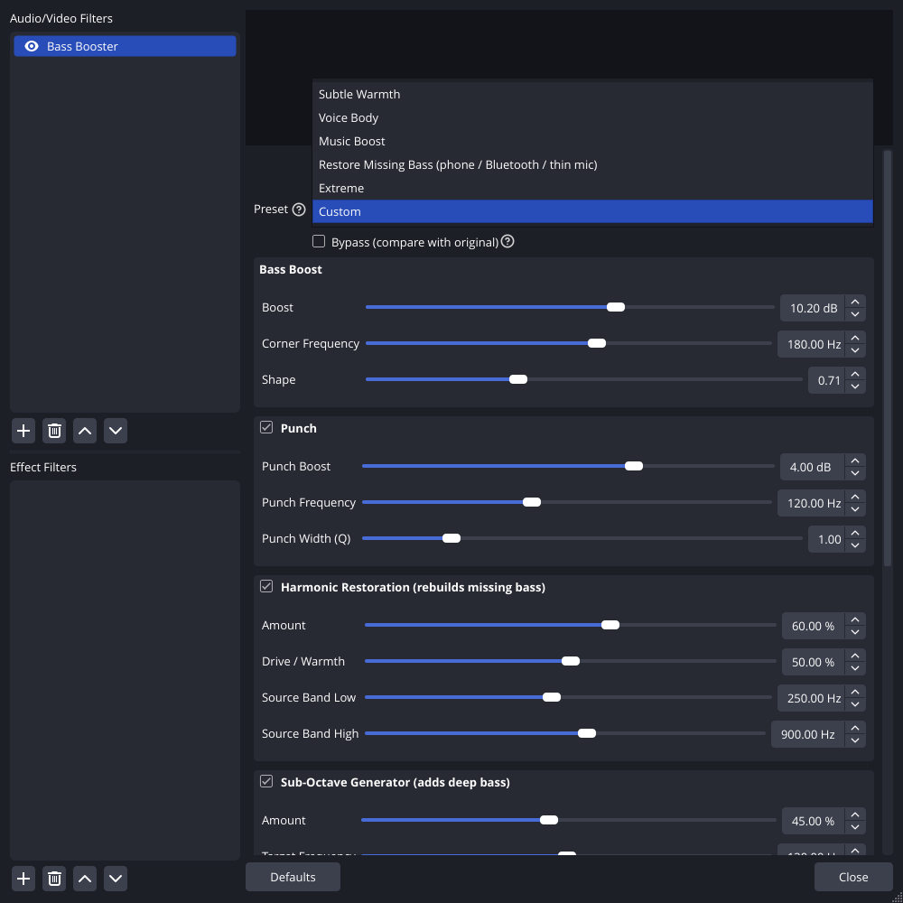
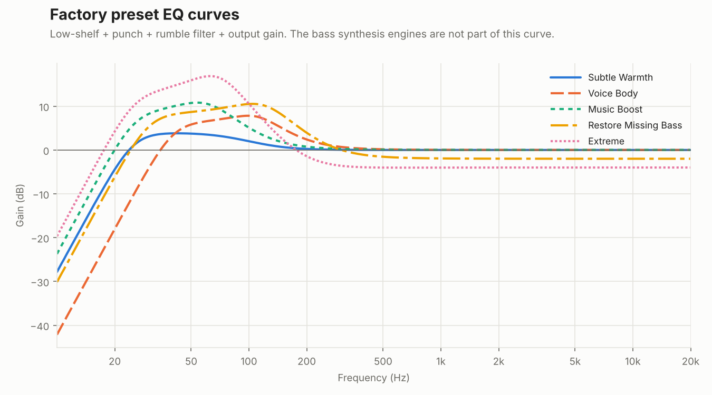

# Bass Booster for OBS: User Guide

This guide covers installing the plugin, choosing a preset, what every control does, and settings for common situations. If your audio has *no bass at all*, read [Step 0](#step-0-find-out-why-the-bass-is-missing) first. It takes five minutes and might fix the problem at the source.

- [Step 0: find out why the bass is missing](#step-0-find-out-why-the-bass-is-missing)
- [Installing](#installing)
- [Adding the filter](#adding-the-filter)
- [Presets](#presets)
- [Every control explained](#every-control-explained)
- [Recipes](#recipes)
- [Filter order](#filter-order)
- [Troubleshooting](#troubleshooting)
- [FAQ](#faq)

---

## Step 0: find out why the bass is missing

Bass Booster can rebuild missing bass, but a clean full-range source always sounds better than a repaired one. Check these first:

| Likely cause | How to check | Fix |
|---|---|---|
| **Bluetooth headset in "Hands-Free" mode.** This is the most common cause. While the headset's mic is in use, Windows and macOS switch it to a phone-quality profile with almost no bass. | Windows *Sound settings* lists two devices, "Headphones" and "Headset (Hands-Free)". | In OBS, capture **"Headphones (Stereo)"** and use a different microphone. |
| **Windows "Audio Enhancements"** or a voice-call profile | *Control Panel → Sound → (device) → Properties → Enhancements / Advanced* | Turn enhancements off. |
| **A low-cut switch on the microphone** | Look for a switch marked with a sloped line on the mic body. | Turn it off. |
| **Another OBS filter** (Noise Suppression, a high-pass EQ…) | Click the eye icon to disable the source's other filters one at a time. | Reorder them, or remove the culprit. |
| **Low-quality app audio** (VoIP, Discord, game chat) | The app's own audio or voice settings | Raise the quality there if it lets you. |

If none of these apply, or you can't change the source, Bass Booster is the right tool.

---

## Installing

| System | Steps |
|---|---|
| **Windows** | Unzip `obs-bass-booster-<version>-windows-x64.zip` into `C:\ProgramData\obs-studio\plugins\`. The result should be `C:\ProgramData\obs-studio\plugins\obs-bass-booster\bin\64bit\obs-bass-booster.dll` and `C:\ProgramData\obs-studio\plugins\obs-bass-booster\data\locale\en-US.ini`. |
| **macOS** | Unzip `obs-bass-booster-<version>-macos-universal.zip` and move `obs-bass-booster.plugin` into `~/Library/Application Support/obs-studio/plugins/`. In Finder, press ⌘⇧G and paste the path. It's a universal binary, so it runs natively on Apple Silicon and Intel. If macOS blocks it, open *System Settings → Privacy & Security* and choose *Allow*. |
| **Ubuntu / Debian** | `sudo apt install ./obs-bass-booster-<version>-x86_64-linux-gnu.deb` |
| **Other Linux** | Extract `obs-bass-booster-<version>-linux-x86_64.tar.xz` into `~/.config/obs-studio/plugins/`. |
| **Flatpak OBS** | Extract the same tarball into `~/.var/app/com.obsproject.Studio/config/obs-studio/plugins/`. |

Restart OBS afterwards. To confirm it loaded, open *Help → Log Files → View Current Log* and look for:

```
[obs-bass-booster] plugin loaded successfully (version 1.0.0)
```

To uninstall, delete the `obs-bass-booster` folder you added, or run `sudo apt remove obs-bass-booster`.

---

## Adding the filter

1. In the **Audio Mixer** dock, click **⋮** next to your source, then **Filters**. You can also right-click the source in the *Sources* list and choose **Filters**.
2. Under **Audio/Video Filters**, click **+** and choose **Bass Booster**.
3. Name it (the default is fine) and click **OK**.



The filter starts on **Restore Missing Bass**. Talk or play audio, and toggle **Bypass** to hear the difference. Settings are saved with your scene collection.

---

## Presets

| Preset | Best for | What it turns on |
|---|---|---|
| **Subtle Warmth** | Audio that is a little thin | +4 dB shelf below 100 Hz. Nothing else. |
| **Voice Body** | Speech that sounds "small" or nasal | +6 dB shelf at 150 Hz, +3 dB chest bump at 110 Hz, light harmonic restoration, 40 Hz rumble filter |
| **Music Boost** | Desktop audio, music, games | +8 dB shelf at 90 Hz, +4 dB punch at 60 Hz, harmonics, 30 % sub-octave |
| **Restore Missing Bass** *(default)* | Phone, Bluetooth hands-free, VoIP, laptop mics: audio with **no bass at all** | +10 dB shelf at 180 Hz, punch at 120 Hz, strong harmonic restoration from the 250–900 Hz band, 45 % sub-octave, −2 dB output to make room |
| **Extreme** | Effects and memes | Everything high. The limiter keeps it from clipping. |
| **Custom** | Selected automatically when you change any control | Your own settings |



Picking a preset overwrites all controls except Bypass. Picking **Custom** never changes anything.

---

## Every control explained

**Bypass (compare with original).** Passes audio through untouched, with a 20 ms crossfade so it never clicks.

### Bass Boost (low-shelf EQ)
| Control | Range | What it does |
|---|---|---|
| **Boost** | −12 … +24 dB | How much to raise the bass. +6 dB is a good start. Negative values cut bass, for a boomy mic. |
| **Corner Frequency** | 20 … 300 Hz | Everything below this is boosted, with half the boost at the corner itself. 80–120 Hz for deep bass, 150–250 Hz for voice body. |
| **Shape** | 0.30 … 1.50 | 0.71 gives a smooth, natural shelf. Higher values add a resonant bump just above the corner. |

### Punch (bell EQ, can be switched off)
| Control | Range | What it does |
|---|---|---|
| **Punch Boost** | −12 … +12 dB | Gain of a focused bump. Negative values remove a boomy resonance. |
| **Punch Frequency** | 30 … 250 Hz | 50–80 Hz for kick-drum thump, 100–150 Hz for voice chest. |
| **Punch Width (Q)** | 0.30 … 4.00 | Higher means narrower. 1.0 is a musical default. |

### Harmonic Restoration (rebuilds missing bass, can be switched off)
This takes the lowest band that **survived** in your audio and runs it through a rectifier. The difference frequencies between neighbouring harmonics land on the **missing fundamental**, at the correct pitch. *Drive* adds extra upper harmonics that make bass audible on phones and earbuds.

| Control | Range | What it does |
|---|---|---|
| **Amount** | 0 … 100 % | How much regenerated bass to add. |
| **Drive / Warmth** | 0 … 100 % | 0 % gives the cleanest result. Higher values sound warmer and grittier. |
| **Source Band Low** | 40 … 500 Hz | Set this to the lowest frequency still present. For phone or Bluetooth audio, 250–300 Hz. |
| **Source Band High** | 150 … 1500 Hz | Top of the analysed band. About 3× the low edge. The plugin keeps it at least 1.5× the low edge. |

### Sub-Octave Generator (adds deep bass, can be switched off)
This creates **new** bass one octave below the input, which follows the dynamics of the source.

| Control | Range | What it does |
|---|---|---|
| **Amount** | 0 … 100 % | Level of the generated sub bass. |
| **Target Frequency** | 40 … 200 Hz | Where the new bass sits. Lower values give deeper rumble, which you need good speakers or headphones to hear. Higher values are more audible on small speakers. |
| **Tightness** | 0 … 100 % | Higher gives a short, punchy sub that tracks the source closely. Lower gives a longer, smoother one. |

### Protection
| Control | Range | What it does |
|---|---|---|
| **Rumble Filter** | 10 … 60 Hz | A 24 dB/octave high-pass. It removes infrasonic energy and DC that you can't hear but that eat headroom. Use 30–40 Hz for voice and 20–25 Hz for music. |

### Limiter (prevents clipping, can be switched off)
| Control | Range | What it does |
|---|---|---|
| **Ceiling** | −12 … 0 dB | The output never exceeds this level. −1 dB is safe for streaming. |
| **Release** | 10 … 1000 ms | How fast the level recovers after a peak. Longer is smoother. |

The limiter adds no delay, so audio/video sync is unaffected. It links all channels, so the stereo image never shifts.

### Output
| Control | Range | What it does |
|---|---|---|
| **Input Trim** | −24 … +24 dB | Gain applied before processing, for very quiet or very hot sources. |
| **Mix (Dry / Wet)** | 0 … 100 % | 100 % is fully processed and 0 % is the original. Values in between blend the two ("parallel" processing). |
| **Output Gain** | −24 … +12 dB | Gain applied after processing and before the limiter. |

**Open User Guide** opens this page.

---

## Recipes

**Phone or Bluetooth hands-free voice (no bass at all).** Start from *Restore Missing Bass*, then:
- If it still sounds thin, raise *Harmonic Restoration → Amount* to 70–80 %.
- If it sounds muddy, lower *Sub-Octave → Amount* to 25 %.
- If the voice "buzzes", lower *Drive*.

**Laptop or webcam microphone.** Use *Voice Body*. If it booms when you lean in, lower *Punch Boost*.

**Desktop audio or music that sounds tinny.** Use *Music Boost*. For more thump, set *Punch Frequency* to 60 Hz and *Punch Boost* to +6 dB.

**A mic that is already full but could be warmer.** Use *Subtle Warmth*. Optionally switch on *Harmonic Restoration* at 15 % with 40 % drive.

**Boomy or muddy mic (too much bass).** Choose *Custom*, set *Boost* to −6 dB at 150 Hz, switch off every generator, and set the *Rumble Filter* to 60 Hz.

**Bass you can hear on phone speakers and earbuds.** Turn up *Harmonic Restoration → Drive*. The extra harmonics let small speakers suggest bass they can't physically reproduce.

---

## Filter order

OBS runs a source's filters from top to bottom. A good order is:

1. Noise Suppression or Noise Gate
2. **Bass Booster**
3. Compressor
4. Limiter (optional; Bass Booster has its own)

Put Bass Booster **after** noise suppression, so it doesn't boost background rumble that the suppressor would have removed.

---

## Troubleshooting

| Symptom | Fix |
|---|---|
| **"Bass Booster" isn't in the + list** | Check the install path (see [Installing](#installing)) and restart OBS. Search the log for `obs-bass-booster`. You need OBS 30 or newer. On macOS, allow the plugin under *Privacy & Security*. |
| **I can't hear any difference** | The filter is probably disabled (eye icon), on Bypass, or Mix is at 0 %. Check your own headphones too: earbuds and laptop speakers can't reproduce deep bass. Use *Audio Mixer → ⋮ → Advanced Audio Properties → Audio Monitoring* to listen. |
| **The meter is in the red / audio distorts** | Keep the limiter switched on with Ceiling at −1 dB. Lower *Output Gain* or *Boost*. |
| **The voice sounds boomy or muddy** | Lower *Boost* or *Sub-Octave Amount*, or raise the *Rumble Filter*. |
| **The low end buzzes or sounds gritty** | Lower *Harmonic Restoration → Drive*. |
| **Bass "pumps" or breathes** | Raise *Limiter → Release* to 300 ms or more, and lower *Boost* so the limiter works less. |
| **The sub bass lags behind fast drums** | Raise *Sub-Octave → Tightness*. |

---

## FAQ

**Does it add latency?** No. Every stage, including the limiter, adds zero samples of delay.

**How much CPU does it use?** About 0.75 % of one core for stereo 48 kHz with every engine running, measured by the benchmark test. The cost is about the same with engines switched off: they keep running silently, so switching one on never produces a click or a slow fade-in.

**Does it work with 5.1 and 7.1 audio?** Yes. Each channel is EQ'd separately. The synthesised bass is generated from the mono sum and added equally to every channel, so the low end stays coherent.

**Will a plugin update break my saved settings?** No. Settings keys are permanent, and any out-of-range value from an older or newer version is clamped safely.

**Can I try settings without OBS?** Yes. `bass-booster-render` runs the same engine on WAV files:

```bash
bass-booster-render --preset restore my-recording.wav fixed.wav
bass-booster-render --preset voice --set shelf_gain_db=9 --set sub_enabled=on in.wav out.wav
bass-booster-render --analyze my-recording.wav        # band levels
bass-booster-render --list-params                     # every --set key
```
