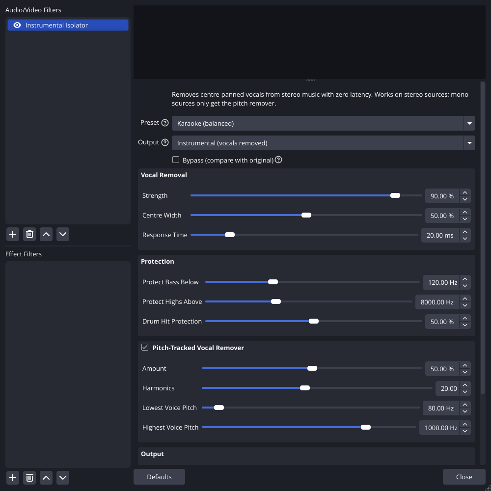
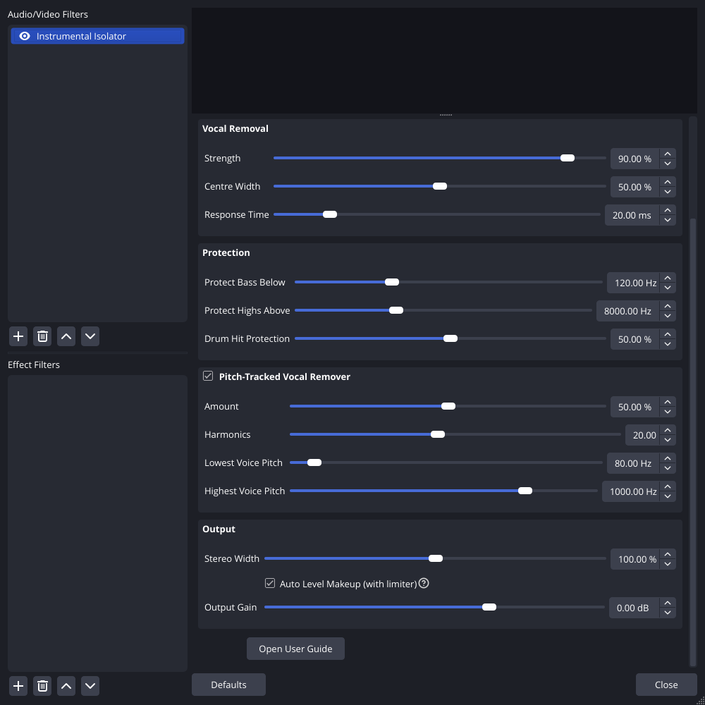
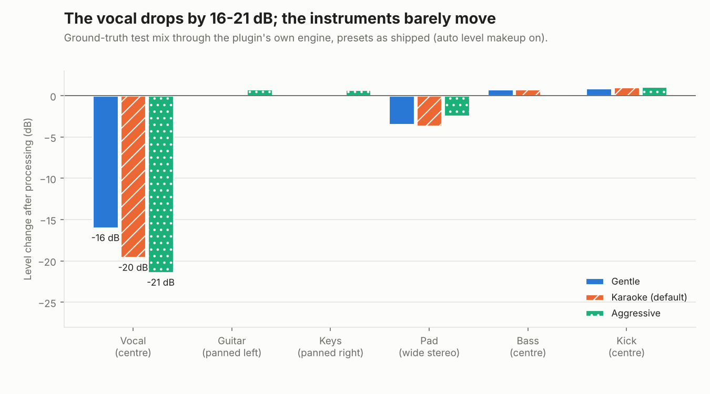

# Instrumental Isolator for OBS

**A real-time vocal remover for OBS Studio that adds zero latency.** It removes the centre-panned vocal from stereo music and leaves the instrumental: karaoke, music beds you can talk over, or "vocals only" for an acapella.

Add it under *Audio Mixer → ⋮ → Filters → + → Instrumental Isolator (Vocal Remover)*.

<p align="center">
  
  
</p>
<p align="center"><sub>These are real screenshots of the plugin running in OBS Studio 30.2.3.</sub></p>



## What "zero latency" means here

The output responds on the **same sample** as the input. There is no buffer and no look-ahead, so the audio stays in sync with your video and with anything else in OBS.

AI stem separators (Demucs, Spleeter, MDX) and FFT-based tools can't do this. They analyse windows of audio, sometimes including what comes next, which adds 20 ms to several seconds of delay. This plugin uses only filters that run sample by sample on current and past audio. The trade-off is that separation is good rather than perfect (see [Limits](#limits)).

## How it works

1. **Adaptive side predictor** (the core): a 256-tap adaptive filter that learns, frequency by frequency, how to predict the *mid* signal (L+R) from the *side* signal (L−R).
   - Every panned instrument appears in both, so its part of the mid is predictable.
   - A centre-panned vocal has no side component at all, so it can't be predicted, and what's left over is the vocal.
   - Unlike the classic "L − R" karaoke trick, instruments keep their proper stereo image and the bass isn't destroyed.
2. **Zero-latency filterbank:** Linkwitz-Riley crossovers that recombine exactly, verified to 10⁻¹⁰. In each band, the side energy that panning can't explain must be spread-out stereo ambience (reverb, pads), so that part is protected. Bass below 120 Hz and highs above 8 kHz always pass untouched.
3. **Pitch-tracked vocal remover:**
   - A pitch detector follows the extracted vocal using only past audio.
   - A gliding bank of notch filters then cuts that voice's harmonics out of what's left.
   - It's the only part that helps on mono sources.
4. **Drum-hit protection:** an energy-based detector briefly eases removal on drum hits, so a centre-panned kick and snare keep their punch.
5. **Output stage:** stereo width, automatic level makeup with a zero-latency limiter, Vocals-only mode, and a click-free Bypass.

## Measured results

Measured on a ground-truth test mix where each part sits on its own frequencies, so each part's level can be measured exactly. The full pass criteria are in the tests.

| Karaoke preset (default) | Change |
|---|---|
| Vocal, centre | **−20 dB** (−16 dB with ±1 % vibrato) |
| Guitar, panned left / Keys, panned right | within ±1.5 dB |
| Bass and kick, centre (protected) | within ±0.5 dB |
| Pad, wide decorrelated stereo | about −4 dB (it loses its centre part and stays wide) |
| Latency | **0 samples** |
| CPU, stereo 48 kHz | about 4 % of one core |

The same numbers hold when measured *through libobs's own audio pipeline* by the end-to-end test: vocal −20.6 dB, guitar −0.9 dB, keys −1.2 dB, bass −0.2 dB.

## Limits

- **Stereo sources only for real separation.** On a mono source, everything is "centre". The plugin detects this and turns centre removal off so it doesn't silence your audio, leaving only the pitch remover, which gives a modest 3–6 dB on a sung note.
- **Lead vocals mixed dead centre**, which is most commercial music. Backing vocals panned to the sides stay in.
- **Vocal reverb that's spread across the stereo field** leaks through faintly.
- **Centre-panned solo instruments** in the vocal range (such as a sax solo) get removed along with the vocal.
- **Partials closer than about 190 Hz** at different pans are only partly separated. That resolution limit is the price of zero latency.

## Install

Same as any OBS plugin. Download from the [Releases page](https://github.com/daren-wallace/claude/releases) or the latest CI artifacts.

| System | Steps |
|---|---|
| **Windows** | Unzip into `C:\ProgramData\obs-studio\plugins\`, so you have `...\plugins\obs-instrumental-isolator\bin\64bit\obs-instrumental-isolator.dll`. |
| **macOS** | Move `obs-instrumental-isolator.plugin` into `~/Library/Application Support/obs-studio/plugins/`. |
| **Ubuntu / Debian** | `sudo apt install ./obs-instrumental-isolator-*-x86_64-linux-gnu.deb` |
| **Other Linux / Flatpak** | Extract the tarball into `~/.config/obs-studio/plugins/`. For Flatpak OBS, use `~/.var/app/com.obsproject.Studio/config/obs-studio/plugins/`. |

Restart OBS, then add the filter to a **stereo** music source. The step-by-step walkthrough, presets, every control and troubleshooting are in **[docs/USER_GUIDE.md](docs/USER_GUIDE.md)**.

## Build and test

```bash
sudo apt install libobs-dev cmake ninja-build xvfb
cmake -S . -B build -G Ninja -DISOLATOR_ENABLE_TESTS=ON
cmake --build build
ctest --test-dir build --output-on-failure
```

```bash
# Offline: process a WAV, or print the separation report on the test mix
build/tools/isolator-render --preset karaoke song.wav song-instrumental.wav
build/tools/isolator-render --report --preset aggressive
```

- **47 unit test cases (about 2 million assertions):**
  - the filterbank recombines exactly, and the Horner shortcut matches full per-band compensation;
  - zero latency;
  - Strength 0 is transparent and Bypass is bit-exact;
  - the separation targets on the test mix, with and without vibrato;
  - Vocals-only mode;
  - the pitch tracker is accurate to 1 % across 82–880 Hz;
  - the comb notches land where they should;
  - drum hits are detected and steady tones aren't;
  - mono and dual-mono input are never silenced;
  - the surround centre channel is handled;
  - auto makeup never clips;
  - output is bit-identical for any buffer size;
  - NaN recovery, a random stress test, and a CPU benchmark.
- **An end-to-end libobs test** (150 checks) loads the compiled plugin and measures separation through OBS's own pipeline. It covers presets and Custom, Vocals-only, Bypass and the filter toggle, and confirms zero leaks.

Architecture and design notes are in [docs/DEVELOPMENT.md](docs/DEVELOPMENT.md).

## License

GPL-2.0-or-later. See [LICENSE](LICENSE).
