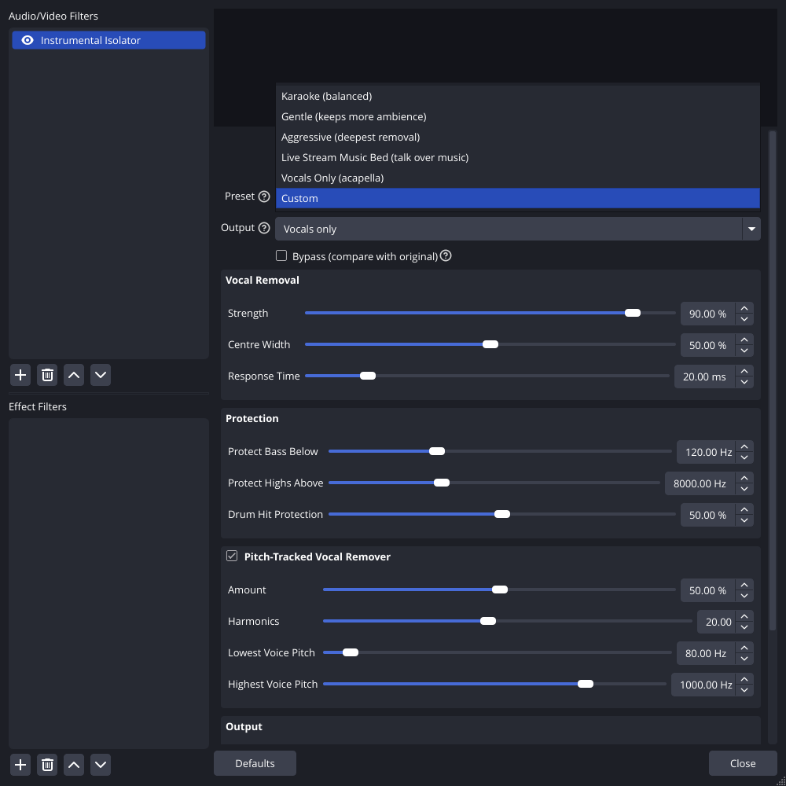

# Instrumental Isolator for OBS: User Guide

- [What it does, and what it can't do](#what-it-does-and-what-it-cant-do)
- [First-time installation, step by step](#first-time-installation-step-by-step)
- [Adding the filter](#adding-the-filter)
- [Presets](#presets)
- [Every control explained](#every-control-explained)
- [Recipes](#recipes)
- [Troubleshooting](#troubleshooting)
- [FAQ](#faq)

---

## What it does, and what it can't do

The filter removes the **lead vocal** from **stereo** music in real time, with **zero added latency**, and leaves the instrumental. It can also do the opposite and keep only the vocal.

It works because almost every commercial song puts the lead vocal **dead centre**, identical in the left and right speakers, while instruments are panned or spread across the stereo field.

| Works well | Works partly | Doesn't work |
|---|---|---|
| Commercial stereo songs with a centred lead vocal | Songs with heavy stereo reverb on the vocal (the reverb tail leaks); backing vocals panned to the sides (they stay) | **Mono** audio (phone, mono mic, mono capture), where only the pitch remover helps, by 3–6 dB |
| Music beds you want to talk over | Live recordings with lots of room sound | Music where an instrument solo sits in the centre (it's removed too) |

Separation is good rather than perfect. That's the trade-off for adding no delay.

---

## First-time installation, step by step

### Windows
1. **Check OBS.** Open OBS, go to *Help → About*, and make sure the version is **30 or newer**. Then close OBS (*File → Exit*).
2. **Download** the `obs-instrumental-isolator-windows-x64` package from the Releases page or the CI artifacts.
3. **Unzip.** Right-click the download, choose **Extract All**, then **Extract**. If there's another zip inside, extract that too. You should end up with a folder named **`obs-instrumental-isolator`** that contains `bin\64bit\obs-instrumental-isolator.dll` and `data\locale\en-US.ini`.
4. **Open the plugins folder.** Press **Win + R**, type `C:\ProgramData\obs-studio` and press Enter. Open the `plugins` folder, or create it if it isn't there.
5. **Copy.** Drag the whole `obs-instrumental-isolator` folder into `plugins`. Click **Continue** if Windows asks for administrator permission.
6. **Check the result.** This file should now exist: `C:\ProgramData\obs-studio\plugins\obs-instrumental-isolator\bin\64bit\obs-instrumental-isolator.dll`.
7. Start OBS and continue with [Adding the filter](#adding-the-filter).

### macOS
1. Download `obs-instrumental-isolator-macos-universal` and unzip it until you see `obs-instrumental-isolator.plugin`.
2. In Finder, press **⌘⇧G**, paste `~/Library/Application Support/obs-studio/plugins/` and press Enter. Create the folder if needed.
3. Drag `obs-instrumental-isolator.plugin` into it.
4. Start OBS. If macOS blocks the plugin, go to *System Settings → Privacy & Security*, click **Allow Anyway**, then restart OBS.

### Linux
- **Ubuntu / Debian:** `sudo apt install ./obs-instrumental-isolator-<version>-x86_64-linux-gnu.deb`
- **Other distributions:** extract the `.tar.xz` into `~/.config/obs-studio/plugins/`.
- **Flatpak OBS:** extract it into `~/.var/app/com.obsproject.Studio/config/obs-studio/plugins/` instead.

**Did it load?** Open *Help → Log Files → View Current Log* and search for `instrumental-isolator`. You should see:

```
[obs-instrumental-isolator] plugin loaded successfully (version 1.0.0)
```

---

## Adding the filter

1. In the **Audio Mixer**, click **⋮** next to your **music** source, then **Filters**.
2. Under **Audio/Video Filters**, click **+**, choose **Instrumental Isolator (Vocal Remover)**, then **OK**.
3. It starts on the **Karaoke** preset. Play a song and toggle **Bypass** to compare.



> **Tip:** to hear the result yourself, open *Audio Mixer → ⋮ → Advanced Audio Properties* and set the source's **Audio Monitoring** to **Monitor and Output**.

> **Make sure the source is stereo.** Media Source, Application Audio Capture and Desktop Audio are stereo. A microphone is usually mono, and the filter can't separate a mono signal.

---

## Presets

| Preset | Use it for |
|---|---|
| **Karaoke (balanced)** *(default)* | Strong vocal removal with instruments intact |
| **Gentle (keeps more ambience)** | Softer removal that keeps more reverb and stereo space |
| **Aggressive (deepest removal)** | Maximum removal. Reverb and pads lose a bit more. |
| **Live Stream Music Bed (talk over music)** | Removes the vocal so your voice isn't competing with the singer, and lowers the level by 3 dB |
| **Vocals Only (acapella)** | Outputs only the extracted vocal |
| **Custom** | Selected automatically when you change any control |

---

## Every control explained

**Output.** *Instrumental* (vocals removed) or *Vocals only*.

**Bypass.** Passes the original audio through untouched, with a 20 ms crossfade so it never clicks.

### Vocal Removal
| Control | Range | What it does |
|---|---|---|
| **Strength** | 0–100 % | From 0 to 50 % it blends from no removal up to the estimated vocal. Above 50 % it removes *more* than the estimate (over-subtraction), for deeper removal at some cost to ambience. |
| **Centre Width** | 0–100 % | Narrow protects reverb and stereo ambience. Wide also removes content that's close to the centre. |
| **Response Time** | 5–100 ms | How quickly removal follows the music. Shorter is snappier; longer is smoother. |

### Protection
| Control | Range | What it does |
|---|---|---|
| **Protect Bass Below** | 40–300 Hz | Bass guitar and kick drum below this are never touched. |
| **Protect Highs Above** | 4–16 kHz | Cymbals and air above this are never touched. |
| **Drum Hit Protection** | 0–100 % | Briefly eases removal on sudden hits, so centre-panned snare and kick keep their punch. |

### Pitch-Tracked Vocal Remover (can be switched off)
This follows the singer's pitch and cuts out that voice's harmonics. It adds removal on top of the main engine and is the only part that works on mono sources.

| Control | Range | What it does |
|---|---|---|
| **Amount** | 0–100 % | How deep the cuts are. |
| **Harmonics** | 4–40 | How many harmonics of the voice to cut. More is stronger, but colours instruments more. |
| **Lowest / Highest Voice Pitch** | 60–400 / 300–1200 Hz | The range of singing pitch to track. |

### Output
| Control | Range | What it does |
|---|---|---|
| **Stereo Width** | 0–200 % | Above 100 % widens what remains, which can fill the hole left by the vocal. |
| **Auto Level Makeup (with limiter)** | on/off | Restores the loudness lost by removing the vocal (up to +6 dB). A zero-latency limiter keeps the output below −1 dBFS. |
| **Output Gain** | −24 to +12 dB | Final level. |

---

## Recipes

- **Karaoke from a music video or Spotify capture.** Use *Karaoke*. If you can still hear the singer, switch to *Aggressive*, or raise *Strength* to 100 %.
- **Talking over music on stream.** Use *Live Stream Music Bed*. Together with a compressor or ducking on your mic, the music stops fighting your voice.
- **The vocal reverb tail still lingers.** Raise *Centre Width* to 70–80 %.
- **Drums sound weak.** Raise *Drum Hit Protection* and *Protect Bass Below*.
- **It sounds hollow.** Raise *Stereo Width* to 120–130 %.
- **Acapella.** Use *Vocals Only*. Lower *Protect Bass Below* if a deep male voice loses body.

---

## Troubleshooting

| Problem | Fix |
|---|---|
| **The filter isn't in the + list** | Check the install path (step 6 above) and that OBS is version 30 or newer, then restart OBS. Check the log for `instrumental-isolator`. |
| **Nothing is removed** | The source is probably **mono** (for example a microphone). Use a stereo source such as Media Source, Application Audio Capture or Desktop Audio. Also check that Bypass is off and Strength is above 0. |
| **The vocal is quieter but not gone** | That's normal with heavy stereo reverb or doubled vocals. Try *Aggressive* and a wider *Centre Width*. |
| **Bass or kick sounds thinner** | Raise *Protect Bass Below* to 150–200 Hz. |
| **The music sounds hollow or phasey** | Lower *Strength* to 70 %, raise *Stereo Width*, or use *Gentle*. |
| **Removal takes a second to kick in** | The predictor learns the song's stereo layout over about a second after a song starts or after Bypass. That's expected. |

---

## FAQ

**Is there really no latency?** Yes. Every stage works sample by sample on current and past audio only. The automated tests check that output responds on the very same sample as the input.

**How much CPU does it use?** About 4 % of one core for stereo at 48 kHz.

**Can I use it together with Bass Booster?** Yes. Put Instrumental Isolator first and Bass Booster after it.

**Does it work on 5.1 / 7.1 audio?** Yes. The front left and right pair is processed as stereo, and the dedicated centre channel (where films and surround mixes put dialogue and vocals) is removed in Instrumental mode.

**Can I try settings without OBS?** Yes:

```bash
isolator-render --preset karaoke song.wav instrumental.wav
isolator-render --mode vocals song.wav acapella.wav
isolator-render --report --preset aggressive        # measured separation on the built-in test mix
isolator-render --list-params                       # every --set key
```
